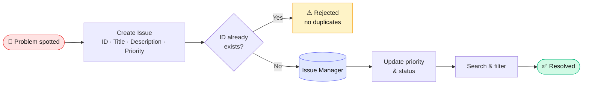
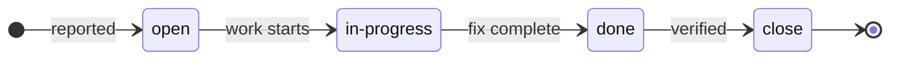
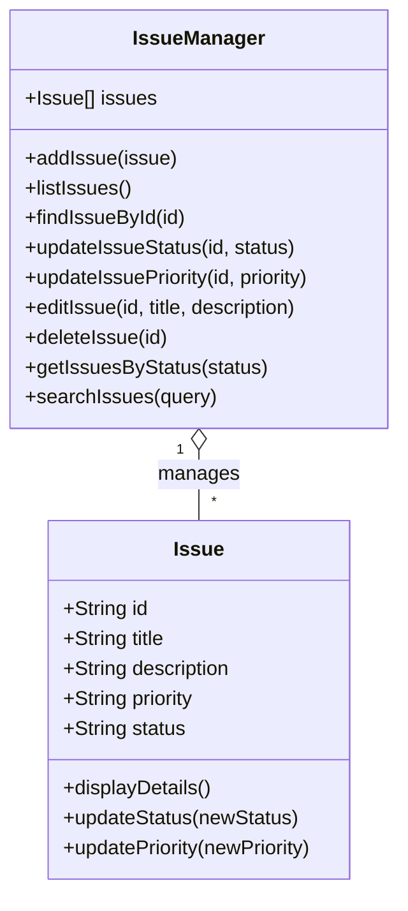

<div align="center">



<br/>

**Application for Job Workflows, Assignments, Issues & Networks**

*A lightweight issue-tracking engine that turns “something is broken” into “it’s fixed.”*

<br/>


[Overview](#-overview) · [How It Works](#-how-it-works) · [Features](#-features) · [Quick Start](#-quick-start) · [API](#-api-reference) · [Roadmap](#-roadmap)

</div>

<br/>

## 💡 Overview

Every team hits problems: a button stops working, a page goes blank, a card disappears. The hard part isn’t noticing — it’s **keeping track**. Who reported it? How urgent is it? Is anyone working on it? Is it done?

**Ajwain** is the engine that answers those questions. It records each problem as an *issue*, lets you rank its urgency, follow its progress, search through it, and close it out.

> **Think of it as a smart to-do list for problems** — with rules that stop it from getting messy.

### Who is this for?

| If you are… | Ajwain gives you… |
|---|---|
| 🧑‍💼 **A manager / non-technical reader** | A clear view of what’s broken, how urgent it is, and what stage it’s in |
| 👩‍💻 **A developer** | A clean, dependency-free JavaScript core you can extend or plug into a UI |
| 🎓 **A learner** | A readable example of prototypes, constructors, and validation in plain JS |

<br/>

## 🔄 How It Works

Every issue travels through a simple life-cycle, from the moment it is reported to the moment it is resolved.



### The life of an issue



> Status and priority values are **validated**. Typing something invalid (e.g. `"banana"`) is safely rejected instead of corrupting your data.

<br/>

## ✨ Features

| | Capability | What it means in plain English |
|:-:|---|---|
| 🆕 | **Create issues** | Log a problem with an ID, title, description and priority |
| 🚫 | **Duplicate protection** | Two issues can never share the same ID |
| 🚦 | **Priority levels** | `low` · `medium` · `high` · `critical` |
| 📈 | **Status tracking** | `open` → `in-progress` → `done` → `close` |
| 🔎 | **Search** | Find issues by any word in the title or description (not case-sensitive) |
| 🗂️ | **Filter by status** | “Show me everything still open” |
| ✏️ | **Edit & delete** | Fix typos, rewrite details, or remove an issue |
| 🛡️ | **Input validation** | Invalid values and unknown IDs are rejected with a clear message |

<br/>

## 🏗️ Architecture

The project is deliberately small and layered. Each piece has **one job**.



| Layer | Analogy | Responsibility |
|---|---|---|
| **`Issue`** | A single ticket | Holds one problem’s details and guards its own status & priority |
| **`IssueManager`** | The filing cabinet | Stores all tickets, prevents duplicates, and handles search, filter, edit and delete |

<br/>

## 📁 Project Structure

```text
ajwain/
├── app.js          # Core engine: Issue + IssueManager (runs in terminal)
├── index.html      # Web entry point (UI in progress)
├── style.css       # Visual styling for the upcoming interface
├── assets/
│   └── banner.svg  # Animated README header
└── README.md
```

<br/>

## 🚀 Quick Start

**Requirements:** [Node.js](https://nodejs.org) (any recent version). No installs, no packages.

```bash
# 1. Clone the repository
git clone https://github.com/<your-username>/<your-repo>.git
cd <your-repo>

# 2. Run the demo
node app.js
```

The demo creates sample issues, changes their status and priority, searches them, edits one, and prints each result to your terminal. Prefer the browser? Open `index.html` and view the output in the developer console (`F12`).

<br/>

## 🧩 Usage Example

```javascript
const manager = new IssueManager();

// 1. Report a problem
const bug = new Issue("AJ-101", "Login failed", "Button not responding", "high");
manager.addIssue(bug);

// 2. Move it forward
manager.updateIssueStatus("AJ-101", "in-progress");
manager.updateIssuePriority("AJ-101", "critical");

// 3. Find it later
manager.searchIssues("login");          // → [ Issue AJ-101 ]
manager.getIssuesByStatus("in-progress"); // → [ Issue AJ-101 ]

// 4. Invalid input is safely rejected
manager.updateIssueStatus("AJ-101", "banana"); // → false
```

<br/>

## 📚 API Reference

<details>
<summary><b>Issue</b> — a single ticket</summary>

<br/>

| Method | Returns | Description |
|---|---|---|
| `new Issue(id, title, description, priority)` | `Issue` | Creates an issue. Status starts as `"open"` |
| `displayDetails()` | `object` | Plain snapshot of the issue |
| `updateStatus(newStatus)` | `string \| false` | Allowed: `open`, `in-progress`, `done`, `close` |
| `updatePriority(newPriority)` | `string \| false` | Allowed: `low`, `medium`, `high`, `critical` |

</details>

<details>
<summary><b>IssueManager</b> — the collection</summary>

<br/>

| Method | Returns | Description |
|---|---|---|
| `addIssue(issue)` | — | Adds an issue; warns and skips if the ID already exists |
| `listIssues()` | `Issue[]` | All issues |
| `findIssueById(id)` | `Issue \| undefined` | Exact ID lookup |
| `updateIssueStatus(id, status)` | `string \| false` | Validated status change |
| `updateIssuePriority(id, priority)` | `boolean` | Validated priority change, with a log of old → new |
| `editIssue(id, title, description)` | `boolean` | Rewrites title and description |
| `deleteIssue(id)` | `boolean` | Removes an issue |
| `getIssuesByStatus(status)` | `Issue[]` | Filter by status |
| `searchIssues(query)` | `Issue[]` | Case-insensitive match on title or description; empty query returns `[]` |

</details>

<br/>

## 🧭 Roadmap

- [x] Core issue model with validated status & priority
- [x] Manager with search, filter, edit and delete
- [x] Duplicate-ID protection
- [ ] Visual web interface (cards, columns, filters)
- [ ] Persistent storage so issues survive a restart
- [ ] Auto-generated issue IDs
- [ ] Assignees and team *networks*
- [ ] Automated tests

<br/>

## 🤝 Contributing

Contributions are welcome.

1. Fork the repository
2. Create a branch: `git checkout -b feature/your-idea`
3. Commit your changes: `git commit -m "Add your idea"`
4. Push and open a Pull Request

<br/>

<div align="center">

**Ajwain** · *From Issues to Outcomes.*

<sub>Built with plain JavaScript and a love for tidy workflows.</sub>

</div>
